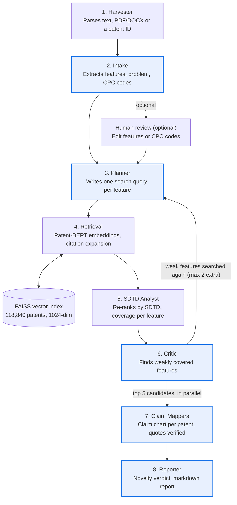

# Patent Prior-Art Search System: Project Overview

## Summary

The system takes an invention description and returns a prior-art report: the closest existing patents, a feature-by-feature claim chart for each, and a novelty verdict. It searches **118,840 Google Patents** with a multi-agent **RAG** pipeline built on **LangGraph** and **Gemini (Vertex AI)**.

Retrieval uses **Patent-BERT** embeddings in a **FAISS** vector index. Results are re-ranked with the **SDTD** formula, which combines text similarity with patent classification distance. The formula comes from the paper "A Novel Patent Similarity Measurement Methodology: Semantic Distance and Technological Distance (SDTD)" (Yoo et al.).

| Fact | Value |
| --- | --- |
| Patents indexed | 118,840 |
| Agents in the graph | 9 (5 call Gemini, 4 are tools) |
| Embedding model | Patent-BERT (`anferico/bert-for-patents`), 1024 dimensions |
| Retrieval quality | Recall@10 0.219, MRR 0.164 against 1,549 real examiner citations |
| Time per search | ~50–80 s in agent mode (8–12 Gemini calls); ~5 s in classic mode |
| Inputs accepted | Free text, a PDF/DOCX upload, or a Google Patent ID |

## How it works end to end

A search runs in seven steps, from raw input to a written report.

1. **Input.** The user submits free text, a PDF/DOCX file, or a Google Patent ID. The Harvester parses the file or fetches the patent.
2. **Understand the invention.** Gemini extracts the title, problem, solution, technical features and predicted CPC codes. The user can optionally review and edit these before the search continues.
3. **Plan queries.** Gemini writes one patent-style search query per feature, plus the original text.
4. **Retrieve.** Each query is embedded with Patent-BERT and searched in FAISS. Patents cited by the top hits are added as extra candidates.
5. **Re-rank.** Candidates are scored with SDTD (text similarity combined with classification overlap), and coverage is measured per feature.
6. **Critique.** Gemini checks which features are poorly covered and sends them back to step 3, for at most 2 extra rounds.
7. **Analyse and report.** For each top candidate, Gemini builds a claim chart in parallel. A final Gemini call writes the novelty verdict and recommendations, saved as a markdown report.

## Agent architecture

The pipeline is a LangGraph `StateGraph` of 9 nodes sharing one state object; a checkpointer saves each run so a paused run can resume after human review.

Blue boxes call Gemini; the others are tools with no LLM. The Critic loops back to the Planner when features are weakly covered; the Claim Mappers then run in parallel through LangGraph's `Send`, one per top candidate.

## Retrieval-Augmented Generation (RAG)

Every statement in the final report is generated from retrieved patent text, not from the LLM's memory. RAG runs only in agent mode (`/api/agent/search`); classic mode retrieves and scores but calls no LLM.

| RAG stage | What happens | Code |
| --- | --- | --- |
| Retrieve | Queries embedded with Patent-BERT, searched in FAISS, expanded with cited patents | [`graph/agents/retrieval.py`](../graph/agents/retrieval.py) |
| Augment | Each top patent's title, abstract and up to 3,000 characters of its claims are inserted into the prompt | [`graph/agents/claim_mapper.py`](../graph/agents/claim_mapper.py) |
| Generate (claim charts) | Gemini marks each feature as disclosed, partial or not found, with a verbatim evidence quote | [`graph/agents/claim_mapper.py`](../graph/agents/claim_mapper.py) |
| Generate (report) | Gemini writes the novelty verdict using only the claim charts | [`graph/agents/reporter.py`](../graph/agents/reporter.py) |
| Feedback loop | Gemini reviews retrieval coverage and triggers new searches for weak features | [`graph/agents/critic.py`](../graph/agents/critic.py) |

**Grounding check.** After Gemini returns a claim chart, the code normalises each evidence quote and checks that it appears in the retrieved patent text. A quote that is not found is marked unverified and flagged in the report as "quote not found in text". This catches hallucinated evidence instead of passing it to the user.

**Prompting.** Each LLM agent has its own prompt and returns **structured output** (Pydantic schemas such as `Invention`, `SearchPlan`, `Critique`, `ClaimChart`), so results are parsed reliably. Fast agents use `gemini-3.5-flash-lite`; claim mapping and the report use `gemini-3.8-flash`, at temperature 0.

## Embeddings and vector search

Each patent's title and abstract is turned into a 1024-dimensional Patent-BERT vector, and queries are matched by cosine similarity in FAISS.

- **Model.** `anferico/bert-for-patents`, a BERT-large model pretrained on patent text, loaded with Hugging Face Transformers and PyTorch ([`train_models/sbert.py`](../train_models/sbert.py)). It is used as-is, not fine-tuned.
- **Input text.** Title + abstract, truncated to 512 tokens.
- **Pooling.** Mean pooling over real tokens only: token vectors are multiplied by the attention mask so padding is excluded ([`agents/retrieval_agent.py`](../agents/retrieval_agent.py)).
- **Normalisation and index.** Vectors are L2-normalised and stored in a FAISS `IndexFlatIP`. Inner product on unit vectors equals cosine similarity, and a flat index gives exact search.
- **Batch embedding.** The full collection was embedded on a Colab GPU in FP16 ([`colab/patent_gpu_embedder.ipynb`](../colab/patent_gpu_embedder.ipynb)); [`build_google_patents_index.py`](../build_google_patents_index.py) rebuilds it locally in batches.
- **Citation expansion.** Patents cited by the strongest hits are looked up in the index and scored against the query vector, adding examiner-chosen candidates that pure vector search can miss.
- **Fine-tuning data (prepared, not trained).** [`finetune/build_pairs.py`](../finetune/build_pairs.py) creates 60,000 weakly supervised pairs of patents that share an exact CPC subgroup, for future contrastive fine-tuning. Patents in the evaluation set are excluded to avoid leakage. A fine-tuned model can be plugged in with `PATENT_ENCODER=<dir>`.

## SDTD hybrid scoring

Candidates are ranked by a score that rewards both similar text and shared patent classification.

$$
\text{SDTD} = \frac{(TD + 1) \cdot SD}{2}
$$

- **SD (Semantic Distance):** Patent-BERT cosine similarity between query and candidate.
- **TD (Technological Distance):** the deepest level at which the query's and candidate's IPC/CPC codes match.

| Deepest matching level | TD |
| --- | --- |
| Section (e.g. H) | 0.25 |
| Class (e.g. H04) | 0.5 |
| Subclass (e.g. H04L) | 0.75 |
| Main group (e.g. H04L9) | 0.9 |
| Exact code | 1.0 |

With no matching code, TD is 0 and the score is half the text similarity. With an exact match, the score equals the text similarity.

## Data pipeline

Patent data comes from the Google Patents public dataset on BigQuery and is stored locally as Parquet.

1. **Pull** ([`pull_google_patents.py`](../pull_google_patents.py)): a SQL query fetches English title, abstract and claims, plus IPC and CPC codes, dates, assignees, inventors, citations and family. Rows need a title and an abstract over 50 characters; `TABLESAMPLE` limits the bytes BigQuery scans (and bills). New pulls are merged with patents already downloaded.
2. **Store**: `data/processed/patents_full.parquet` holds every field; `index_records.parquet` holds what gets embedded (ID, title + abstract, codes, URL).
3. **Embed and index** ([`build_google_patents_index.py`](../build_google_patents_index.py) or the Colab notebook): writes `patents_faiss.index` and `patents_meta.parquet`, keeping the previous files as backups.
4. **Serve**: at search time, claims and citations are read from `patents_full.parquet` for citation expansion and claim charts.

## Evaluation

On real examiner citations, the system finds about 22% of cited prior art in its top 10 results across all 118,840 patents.

**Method** ([`finetune/evaluate.py`](../finetune/evaluate.py)): 796 indexed patents cite 1,549 other indexed patents. Each citing patent's vector is searched against the full index, and the ranks of its cited patents are recorded.

| Ranking | Recall@10 | Hit@10 | Recall@50 | MRR |
| --- | --- | --- | --- | --- |
| SD only (Patent-BERT cosine) | 0.216 | 0.270 | 0.351 | 0.168 |
| SDTD (Patent-BERT + CPC) | 0.219 | 0.275 | 0.345 | 0.164 |

Recall@k is the share of cited patents found in the top k. Hit@10 is the share of queries with at least one cited patent in the top 10. MRR is the average of 1 / rank of the first cited patent found.

**Pooling bug fix.** An earlier index averaged padding tokens into each embedding. Masking them out raised SD Recall@10 from 0.184 to 0.216, about 17%.

**Encoder comparison** ([`finetune/compare_encoders.py`](../finetune/compare_encoders.py)) on 10,000 computer-science patents (CPC G06, G16, H04L), with 527 queries and 1,255 citations:

| Encoder | SD Recall@10 | SDTD Recall@10 |
| --- | --- | --- |
| all-mpnet-base-v2 (general SBERT) | 0.346 | 0.349 |
| PatentSBERTa (patent SBERT) | 0.270 | 0.296 |
| Patent-BERT (used in the app) | 0.270 | 0.229 |

The general-purpose model scored highest on this subset, which suggests switching encoders or fine-tuning Patent-BERT as a next step.

## Web app and API

A Flask app ([`app.py`](../app.py)) serves the UI and exposes two search modes. Agent mode streams each agent's progress live to an Agent Trace panel as NDJSON events.

| Endpoint | Method | Purpose |
| --- | --- | --- |
| `/` | GET | Web UI (`templates/index.html`, `static/`) |
| `/api/agent/search` | POST | Agent mode: full LangGraph RAG search, streamed |
| `/api/agent/resume` | POST | Resumes a run paused for human review, with edited features or CPC codes |
| `/api/search` | POST | Classic mode: retrieval + SDTD scoring only, no LLM, ~5 s |
| `/api/download_report` | GET | Downloads the generated report |
| `/api/health` | GET | Health check |

The same graph also runs from the command line with `run_agent_graph.py`. Deployment config for Render is included (`render.yaml`, `Procfile`).

## Tech stack and repository layout

| Area | Tools |
| --- | --- |
| Agents and LLM | LangGraph, LangChain (`langchain_google_genai`), Gemini on Vertex AI, Pydantic |
| Embeddings | PyTorch, Hugging Face Transformers, Patent-BERT |
| Vector search | FAISS |
| Data | Google BigQuery, pandas, PyArrow, Parquet |
| Web | Flask, HTML/CSS/JavaScript, NDJSON streaming |
| Compute | Google Colab GPU for batch embedding |

| Path | Contents |
| --- | --- |
| `graph/` | LangGraph pipeline: `build.py` (graph), `state.py`, `llm.py` (Gemini setup), `runner.py`, `tools.py` |
| `graph/agents/` | One file per agent: harvester, intake, review, planner, retrieval, analyst, critic, claim_mapper, reporter |
| `agents/` | Classic pipeline and shared tools: retrieval (embedding + FAISS), analyst (SDTD), harvester (parsing, scraping), orchestrator |
| `train_models/sbert.py` | Patent-BERT wrapper |
| `finetune/` | Evaluation, encoder comparison, fine-tuning pair builder |
| `colab/` | GPU embedding and encoder comparison notebooks |
| `pull_google_patents.py`, `build_google_patents_index.py` | Data pull and index build |
| `app.py`, `templates/`, `static/` | Flask web app |

## Limitations and future work

- **Encoder choice.** Patent-BERT trailed a general SBERT model on the 10k benchmark (0.270 vs 0.346 Recall@10). Next step: switch encoders or fine-tune on the 60,000 prepared pairs.
- **SDTD gain is small.** On the full index it changes Recall@10 only from 0.216 to 0.219, so classification overlap adds little beyond text similarity here.
- **Coverage.** 118,840 patents is a sample of Google Patents, so true prior art outside the sample cannot be found.
- **Latency and cost.** Agent mode takes ~50–80 s and 8–12 Gemini calls per search.
- **Exact search.** A flat FAISS index scales linearly; a much larger collection would need an approximate index such as IVF or HNSW.
